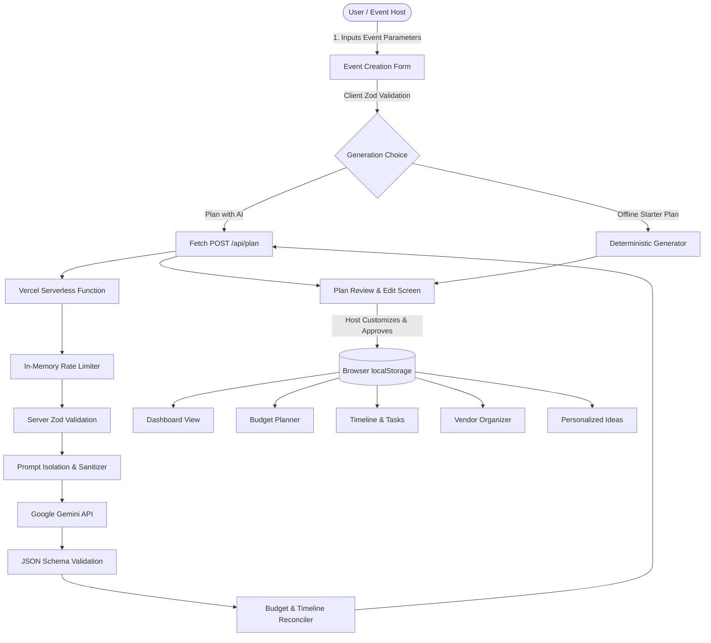

# Planora AI

**Plan celebrations with clarity, creativity, and confidence.**

> **PromptWars Challenge 5**  
> **Assigned Vertical:** Celebration & Event Planner  
> **Mission Brief:** *"Create a GenAI-powered planning assistant that helps users organize weddings, birthdays, and community events with budgets, timelines, vendor checklists, and personalized ideas."*

---

## 1. Problem Statement

Organizing milestone celebrations—from weddings and landmark birthdays to cultural festivals and community fundraisers—is notoriously stressful. Hosts must balance complex spreadsheets, shifting vendor quotes, tight deadlines, dietary constraints, accessibility needs, and unpredictable weather. Existing planning software is often fragmented: generic checklist apps lack contextual intelligence, while raw generative AI tools produce unstructured, hallucinated timelines and inaccurate financial arithmetic that cannot be verified or executed.

---

## 2. Proposed Solution

**Planora AI** bridges generative creativity with deterministic engineering. It pairs Google Gemini's contextual reasoning with a client-side mathematical calculation engine and offline starter planning algorithms. 

Planora AI delivers:
- **Intelligent Context-Aware Planning**: Tailors plans to guest count, indoor/outdoor settings, dietary requirements, cultural traditions, accessibility needs, and host priorities.
- **Deterministic Financial Engine**: Cent-accurate budget allocations across standard categories, variance tracking, overspending detection, and algorithmic savings suggestions.
- **Actionable Timeline & Checklist**: Urgency-aware task scheduling, automatic deadline adjustments for short planning windows, and outdoor weather contingencies.
- **Vendor Directory & Comparison**: Centralized contact tracking, quoted fee comparisons, and safe website URL handling.
- **Curated Celebration Ideas**: Contextual themes, menus, and activities with bookmarking.
- **Offline Reliability & Privacy**: Full functionality via browser `localStorage` without mandatory cloud accounts; graceful fallback to deterministic starter plans if the AI service is unconfigured or unreachable.
- **Multi-Format Data Portability**: Complete JSON backup export/restore, RFC 4180 CSV export for budgets, checklists, and vendors, plus executive print-ready dossiers.

---

## 3. Key Features

| Feature Area | Capabilities |
| :--- | :--- |
| **Dashboard** | Real metrics derived from saved events: total budget, allocated vs. actual spend, completed checklist percentage, next critical deadline, and empty-state onboarding. |
| **Event Creator & AI Planner** | Multi-factor event specification form with live Zod validation. Prompts Google Gemini on the server with bounded context; provides a plan review & edit screen before saving. |
| **Offline Starter Plan** | Generates an intelligent, deterministic starter checklist and budget distribution if the Gemini API key is unconfigured, ensuring users are never blocked. |
| **Budget Planner & Ledger** | Real-time category allocation editing, itemized expense tracking (estimated vs. actual), overspending alerts, unallocated fund tracking, and automated savings suggestions. |
| **Timeline & Tasks** | Milestone tracking with status toggles (`not_started`, `in_progress`, `completed`), urgency badges (`urgent`, `high`, `medium`, `low`), overdue detection, category filters, and custom task creation. |
| **Vendor Organizer** | Directory tracking vendor contact details, booking status (`inquired`, `contacted`, `shortlisted`, `booked`, `declined`), quoted fees, and side-by-side shortlist comparison. |
| **Personalized Ideas** | Curated inspirations across themes, food & catering, guest activities, invitations, budget alternatives, and accessibility arrangements. |
| **Settings & Data Management** | Versioned browser persistence (`planora_ai_state_v1`), JSON backup download, backup file restore, and complete factory reset with confirmation. |
| **Data Export & Print** | RFC-compliant CSV downloads for budgets, tasks, and vendors; complete JSON export; browser print layout styling for executive dossiers. |

---

## 4. Application Architecture

```
planora-ai/
├── api/
│   ├── plan.ts                     # Vercel serverless function (POST /api/plan)
│   └── _lib/
│       ├── gemini.ts               # Google Gen AI SDK wrapper, prompt isolation, JSON schema
│       └── rate-limit.ts           # Per-IP sliding-window rate limiter
├── public/
│   ├── favicon.svg                 # Planora brand mark (compass & celebration spark)
│   └── site.webmanifest            # Web application manifest
├── src/
│   ├── types/
│   │   ├── event.ts                # TypeScript domain models (EventPlan, Task, Budget, Vendor, Idea)
│   │   └── api.ts                  # API request and response schemas
│   ├── lib/
│   │   ├── validation/schemas.ts   # Zod validation schemas & URL security sanitizers
│   │   ├── budget/calculations.ts  # Deterministic money math (minor units), summaries, savings rules
│   │   ├── timeline/generator.ts   # Timeline lead times, deadline logic, deterministic starter tasks
│   │   ├── storage/localStorage.ts # Versioned localStorage engine with defensive recovery
│   │   └── export/formatters.ts    # JSON and RFC 4180 CSV export utilities
│   ├── components/
│   │   ├── brand/PlanoraLogo.tsx   # Original SVG brandmark & typography
│   │   └── common/
│   │       ├── Header.tsx          # Top bar with event switcher and export actions
│   │       ├── Sidebar.tsx         # Responsive navigation sidebar & drawer
│   │       ├── Modal.tsx           # Accessible dialog (Escape key, focus handling, ARIA)
│   │       └── ExportModal.tsx     # Multi-format export dialog
│   ├── features/
│   │   ├── dashboard/DashboardView.tsx # Real-time event overview & metrics
│   │   ├── planner/PlannerView.tsx     # AI planning workflow & dossier highlights
│   │   ├── events/
│   │   │   ├── EventCreateModal.tsx    # Event creation form with dual AI / starter pathways
│   │   │   ├── EventReviewModal.tsx    # Plan preview & customization screen
│   │   │   └── EventListView.tsx       # Saved celebration manager with delete confirmations
│   │   ├── budget/BudgetView.tsx       # Category allocation and expense ledger CRUD
│   │   ├── timeline/TimelineView.tsx   # Milestone filters, priority badges, task CRUD
│   │   ├── vendors/VendorView.tsx      # Vendor ledger, URL safety, and shortlist comparison
│   │   ├── ideas/IdeasView.tsx         # Inspiration cards with category filtering
│   │   └── settings/SettingsView.tsx   # Persistence diagnostics, backup export/restore, reset
│   ├── styles/
│   │   ├── tokens.css              # Warm ivory, deep indigo, and violet design tokens
│   │   ├── globals.css             # Layout, focus outlines, buttons, tables, cards
│   │   └── print.css               # Clean print styles for event dossier printouts
│   ├── App.tsx                     # Top-level state coordination and view routing
│   └── main.tsx                    # React application bootstrap
├── tests/
│   ├── setup.ts                    # Vitest environment setup & browser API polyfills
│   ├── budget.test.ts              # Financial calculations & overspending tests
│   ├── validation.test.ts          # Zod schema & URL security tests
│   ├── timeline.test.ts            # Timeline deadlines & starter checklist tests
│   ├── storage.test.ts             # LocalStorage persistence & corruption recovery tests
│   ├── api-plan.test.ts            # Serverless API handler, rate limiting, and error tests
│   ├── components.test.tsx         # React Testing Library component tests
│   ├── export.test.ts              # JSON & CSV export formatter tests
│   └── gemini.test.ts              # Prompt isolation & markdown stripping tests
├── .env.example                    # Environment variable template (placeholders only)
├── .gitignore                      # Safe Git exclusions (no secrets, dist, node_modules)
├── index.html                      # Semantic HTML5 entry with meta headers
├── package.json                    # Dependency and script definitions
├── tsconfig.json                   # Strict TypeScript compiler configuration
├── vercel.json                     # Vercel deployment routes and security headers
├── vite.config.ts                  # Vite build config & local dev API middleware
└── README.md                       # Comprehensive project documentation
```

---

## 5. Technology Stack

- **Frontend:** React 18, TypeScript (Strict), Vite 6, Semantic HTML5, CSS Variables (Design Tokens), Lucide React.
- **Backend:** TypeScript Serverless Functions (`api/plan.ts`), Vercel Functions runtime.
- **AI Integration:** Official `@google/genai` (v2.30.0) SDK with fallback to `@google/generative-ai` (v0.24.1). Default model: `gemini-2.5-flash`.
- **Validation:** Zod schemas on both server and client.
- **Testing:** Vitest 2, `@testing-library/react`, `@testing-library/jest-dom`, JSDOM.
- **Data Persistence:** Browser `localStorage` (Namespace: `planora_ai_state_v1`, Schema Version: 1).
- **Package Management:** npm with committed `package-lock.json`.

---

## 6. How the Application Works



1. **User Input:** Host provides required details (event name, event type, date, location, guest count, budget, currency) and optional preferences (theme, dietary restrictions, accessibility needs, traditions, priorities, notes).
2. **Path Selection:** Host can select **"Generate Plan with Gemini"** or **"Use Starter Plan (Offline)"**.
3. **Server-Side API Call:** When AI is selected, the validated payload is sent to `/api/plan`. The server verifies client rate limits, checks for `GEMINI_API_KEY`, encapsulates untrusted user notes within boundary tags, and requests structured JSON output from Gemini.
4. **Validation & Reconciliation:** The model's response is validated against `generatedPlanSchema`. Category percentages are verified and normalized to sum cleanly to 100%, and lead times are mapped to real calendar dates.
5. **Plan Review:** The user inspects and edits the overview, theme direction, allocations, and tasks in `EventReviewModal` before committing to storage.
6. **Persistence & Operations:** The plan is saved to `localStorage`. Hosts manage expenses, checklist tasks, vendors, and ideas across dedicated interfaces with full offline availability.

---

## 7. Context-Aware Decision-Making Logic

Planora AI implements deterministic rules to ensure contextual realism:

1. **Guest Count Scaling**: Prompts and starter algorithms adjust logistics based on attendance. Small gatherings (<40 guests) focus on intimate dining and personal favors; large events (>200 guests) emphasize queue management, buffet flow, and audio distribution.
2. **Outdoor Weather Contingencies**: For events marked `outdoor` or `mixed`, the system automatically surfaces shelter, canopy, and power backup recommendations without fabricating real-time weather forecasts.
3. **Accessibility Accommodations**: When mobility needs are indicated, venue selection criteria and starter checklists enforce step-free pathways, reserved seating, and accessible restrooms.
4. **Dietary Customization**: Banquet and refreshment plans adapt to declared restrictions (vegetarian, Jain, vegan, gluten-free, halal).
5. **Short Planning Window Compression**: If an event date is fewer than 14 days away, starter task lead times are compressed into the remaining days and flagged with `urgent` priority.

---

## 8. Budget and Timeline Calculation Approach

### Financial Arithmetic (Minor Units)
To prevent JavaScript floating-point rounding errors (e.g., `0.1 + 0.2 = 0.30000000000000004`), Planora AI processes all money calculations in integer minor units (cents / paise) via `toCents()` and `fromCents()`.

$$\text{cents} = \operatorname{round}(\text{amount} \times 100)$$

- **Total Planned Allocation:** $\sum \text{allocatedAmount}_i$
- **Total Actual Spend:** $\sum \text{actualCost}_i$
- **Total Estimated Spend:** $\sum \text{estimatedCost}_i$
- **Remaining Budget:** $\text{Total Budget} - \max(\text{Total Actual}, \text{Total Estimated})$
- **Deficit / Overspend Flag:** Triggered whenever active spend exceeds total budget.
- **Allocation Normalization:** Distributes residual fractional cents to the final category so the sum of allocations equals the total budget with zero rounding drift.

### Timeline Lead Times
Task deadlines are calculated relative to the event date using timezone-agnostic UTC day boundaries:

$$\text{daysDiff} = \operatorname{round}\left(\frac{\text{Date}_{\text{event}} - \text{Date}_{\text{ref}}}{86{,}400{,}000}\right)$$

- **Overdue Task:** $\text{dueDate} < \text{currentDate} \land \text{status} \neq \text{completed}$
- **Urgent Task:** $0 \le \text{daysUntilDue} \le 3 \land \text{status} \neq \text{completed}$

---

## 9. Gemini Integration & Model Configuration

Planora AI integrates with Google Gemini via official Node.js SDKs exclusively on the server.

### Supported Environment Variables
```bash
GEMINI_API_KEY=your_gemini_api_key_here
GEMINI_MODEL=gemini-2.5-flash
```

- Supported models: `gemini-2.5-flash` (default, recommended for speed and structured outputs), `gemini-2.5-pro`, `gemini-1.5-flash`.
- **System Prompt Boundaries:** User notes are wrapped in `<untrusted_user_notes>` tags with explicit instructions preventing prompt injection or constraint override.
- **Response Format:** Requests JSON output (`responseMimeType: 'application/json'`). Strips any accidental markdown wrappers (` ```json `).
- **Graceful Fallback:** If `GEMINI_API_KEY` is not present, `/api/plan` returns HTTP 503 with an explanation. The frontend alerts the user and provides a one-click button to generate a deterministic starter plan.

---

## 10. Security & Privacy Measures

1. **Zero Secret Leakage:** `GEMINI_API_KEY` is accessed only within `api/plan.ts`. It is never bundled into frontend assets or saved in `localStorage`.
2. **Input Validation:** All client form inputs and API payloads are strictly validated using Zod schemas with length constraints (e.g. notes capped at 1500 characters).
3. **Safe URL Handling:** Vendor website links are validated with `isValidHttpUrl()`. Protocols other than `http:` and `https:` (such as `javascript:`, `data:`, `vbscript:`) are rejected.
4. **No Arbitrary HTML Rendering:** Planora AI does not use `dangerouslySetInnerHTML`. All model responses are parsed into structured data before rendering via React JSX.
5. **Client Rate Limiting:** An in-memory sliding-window limiter on `/api/plan` restricts requests to 15 per minute per client IP.
6. **Security Headers:** Configured in `vercel.json` (Content-Security-Policy, X-Content-Type-Options: nosniff, X-Frame-Options: DENY, Referrer-Policy).
7. **Privacy Sandbox:** Personal event information remains strictly in browser `localStorage`. No analytics or user trackers are included.

---

## 11. Accessibility Considerations (WCAG 2.2 AA)

- **Semantic Landmarks:** `<header role="banner">`, `<aside aria-label="Main Navigation">`, `<main role="main">`, `<footer role="contentinfo">`.
- **Visible Focus States:** `:focus-visible` styling with 2px indigo outline and 2px offset.
- **Keyboard Navigation:** Full tab order traversal. Modals trap focus and listen for `Escape` to close.
- **Screen Reader Support:** Explicit `<label for="...">` on all inputs; descriptive `aria-label` attributes on icon-only action buttons.
- **Multi-Modal Status Indicators:** Statuses are never conveyed solely through color; text badges and icons accompany every state (e.g., Overdue, Urgent, Paid, Booked).
- **Reduced Motion:** Respects `@media (prefers-reduced-motion: reduce)` by disabling transitions and animations.
- **High Contrast:** Complies with AA contrast ratios against warm ivory (`#fcfbf9`) and white card surfaces.

---

## 12. Testing Approach & Verification

Automated testing is powered by **Vitest** and **React Testing Library**.

### Test Suite Structure
| Test File | Focus Area |
| :--- | :--- |
| `tests/budget.test.ts` | Minor-unit conversions, allocation normalization, overspending alerts, savings rules. |
| `tests/validation.test.ts` | Zod schema validation, required fields, date formats, XSS URL scheme blocking. |
| `tests/timeline.test.ts` | Overdue calculation, urgency detection, starter checklist generation. |
| `tests/storage.test.ts` | LocalStorage persistence, multi-event isolation, corrupted JSON recovery, factory reset. |
| `tests/api-plan.test.ts` | Serverless API handler, method rejection (405), missing API key (503), rate limiting (429). |
| `tests/components.test.tsx` | React component rendering, dashboard metrics, budget tables, modal accessibility. |
| `tests/export.test.ts` | RFC 4180 CSV escaping, JSON data backup structures. |
| `tests/gemini.test.ts` | Bounded prompt construction, prompt injection defense, markdown stripping. |

### Running Checks

```bash
# Type check with strict TypeScript
npm run typecheck

# Execute automated Vitest test suite
npm run test

# Run tests with coverage
npm run test:coverage

# Build production assets
npm run build
```

---

## 13. Installation & Local Development

### Prerequisites
- **Node.js:** v18.0.0 or higher (v22 LTS recommended)
- **npm:** v9.0.0 or higher
- **Git**

### Step-by-Step Setup

1. **Clone the repository:**
   ```bash
   git clone <repository-url>
   cd planora-ai
   ```

2. **Install dependencies:**
   ```bash
   npm install
   ```

3. **Configure environment variables:**
   ```bash
   cp .env.example .env
   ```
   Open `.env` and add your Google Gemini API key:
   ```env
   GEMINI_API_KEY=AIzaSy...
   GEMINI_MODEL=gemini-2.5-flash
   ```
   *(Note: The application will run locally and allow full planning even without an API key using the deterministic starter plan engine).*

4. **Start the local development server:**
   ```bash
   npm run dev
   ```
   Open `http://localhost:5173` in your browser. The Vite dev server includes built-in middleware handling `POST /api/plan` calls locally.

5. **Verify code quality:**
   ```bash
   npm run typecheck
   npm run test
   npm run build
   ```

---

## 14. Deployment Instructions

### Vercel Deployment (Recommended)

Planora AI is engineered for zero-config Vercel deployment hosting both the Vite frontend and `/api/plan` serverless function.

#### Method 1: Vercel Web Dashboard
1. Push your repository to GitHub.
2. In the Vercel Dashboard, select **Add New Project** and import the repository.
3. Framework Preset will auto-detect as **Vite**.
4. In **Environment Variables**, add:
   - `GEMINI_API_KEY`: Your Google AI Studio API key.
   - `GEMINI_MODEL`: `gemini-2.5-flash` (optional).
5. Click **Deploy**.

#### Method 2: Vercel CLI
```bash
npm install -g vercel
vercel login
vercel
vercel env add GEMINI_API_KEY
vercel --prod
```

---

## 15. Demonstration Scenarios

### Scenario 1: Budget-Conscious Birthday Party
1. Click **"+ New Event"** on the Dashboard.
2. Enter Name: `Aarav's 30th Birthday`, Type: `Birthday Party`, Date: 30 days ahead, Location: `Mumbai`, Guests: `35`, Budget: `₹50,000`.
3. Click **"Generate Plan with Gemini"** (or **"Use Starter Plan"**).
4. Review the generated breakdown in the review modal and click **"Save & Activate Plan"**.
5. Navigate to **Budget Planner**. Inspect the ₹50,000 allocation across Venue, Catering, and Decor.
6. Click **"Add Expense Item"**: Title `Custom Birthday Cake`, Category `Food & Catering`, Cost `₹4,500`.
7. Observe the remaining balance and utilization update immediately.

### Scenario 2: Outdoor Wedding with Accessibility Needs
1. Open the event creation form.
2. Enter Type: `Wedding`, Setting: `Outdoor (Beach/Lawn)`.
3. Open additional preferences and enter Accessibility Needs: `Wheelchair ramp required for elderly grandparents`.
4. Generate the plan.
5. In **Timeline & Tasks**, observe the automatically surfaced **"Weather Contingency & Shelter Plan"** and **"Verify Venue Accessibility & Seating Accommodations"** tasks.
6. Toggle tasks complete and observe the progress bar update.

### Scenario 3: Community Gathering with Tight Deadline
1. Create an event with a date just 6 days from today.
2. Observe how the timeline compressor schedules tasks within the 6-day window and flags initial permits and volunteer duties as `urgent`.
3. Add a vendor in **Vendor Organizer** with a quote exceeding the budget.
4. Open **Budget Planner** and observe the overspending alert banner.

### Scenario 4: AI Service Unavailable / Offline Mode
1. Run Planora AI without a `GEMINI_API_KEY`.
2. Submit the event creation form with Gemini.
3. Observe the informative banner explaining that `GEMINI_API_KEY` is not configured on the server.
4. Click **"Continue with Deterministic Starter Plan"**.
5. The celebration plan is populated with structured budget categories and milestone tasks without fabricated data.

---

## 16. Assumptions and Limitations

- **Browser Storage Scope:** Event data is stored in the browser's `localStorage`. Clearing browser data will delete local plans. Users can download complete JSON backups via **Settings & Data** to migrate between machines.
- **No Third-Party User Telemetry:** Planora AI does not track user behavior or send event notes to third-party analytics services.
- **AI Quotas:** Gemini API requests are subject to Google AI Studio rate limits and quotas.
- **Vendor Directory:** Vendor entries are user-managed records; Planora AI does not endorse or guarantee real-time availability of third-party vendors.

---

## 17. License

MIT License. Developed for **PromptWars Challenge 5: Celebration & Event Planner**.
